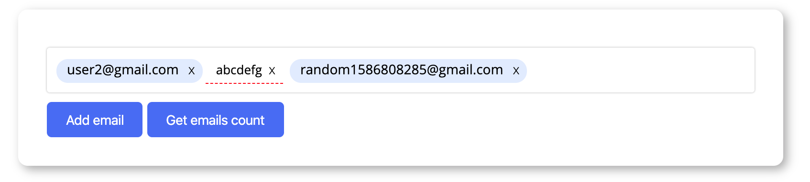

Emails Input — Zero-Dependency Vanilla JS Component (Miro 2020 Assessment)
==========================================================================

> **Live GitHub Pages Retrospective, Browser Internals Review & In-Browser Mocha Test Suite**:
> - **Full Retrospective & Browser DOM Internals Breakdown**: **[https://nodesman.github.io/miro-codingtest-2020-retrospective/](https://nodesman.github.io/miro-codingtest-2020-retrospective/)**
> - **Standalone Multi-Instance Live Demo**: **[https://nodesman.github.io/miro-codingtest-2020-retrospective/public/](https://nodesman.github.io/miro-codingtest-2020-retrospective/public/)**
> - **Live Browser Mocha + Chai + Spies Test Suite**: **[https://nodesman.github.io/miro-codingtest-2020-retrospective/test/](https://nodesman.github.io/miro-codingtest-2020-retrospective/test/)**
>
> **Architectural Highlights (315 LOC, Zero Dependencies)**: Built directly on a composite `contentEditable="true"` surface housing `contentEditable="false"` pill islands and bare `Node.TEXT_NODE` leaves—featuring W3C `Selection`/`Range` caret anchoring, native `Backspace` DOM-desync guards, CSS anonymous text-box color inheritance, bubbling `focusin`/`focusout` + `O(1)` click delegation, zero-`innerHTML` XSS safety, and IE11 (`Trident`) + modern browser compatibility.
>
> *Note: While I passed this coding round at Miro, the role ultimately did not pan out for other reasons.*

---



A email input field without any dependencies. This input field supports:

1. Pasting a set of email addresses 
2. Interfacing with other components
3. Has events to notify listeners

USAGE
=====

Checkout this repository and then build using the <a href="#build">instructions below</a>. 
Include the files `emails-input.js` and `emails-input.css` from the `dist` directory in your web page where you want to 
use the component.  

In your page, create a host element:
```$html
<div class="emails-list-container"></div>
```

Instantiate an instance of the element using:

```$js
var element = document.querySelector(".emails-list-container");
var instance = EmailsInput(element, {
    placeholder: "Add more teammates ... "
});
``` 

API
===

In all the following examples `instance` represents an instance of the `EmailsInput` class. Such as in the statement below:

```$xslt
var instance = new EmailsInput(document.querySelector("#host"), {
    placeholder: "Add more ... "
});
```

### addEmail(strEmail)

Example:
```$xslt
instance.addEmail("user@gmail.com");
```

### getEmails()

Get all valid emails in the instance as a list of strings.

Example:
```$xslt
instance.getEmails() // returns ["test@gmail.com", "test2@gmail.com"]
```

Accepts a string as the first argument which is the email to be added to the emails input instance. 

### getAllItems()

Example:
```$xslt
instance.getAllItems(); // returns ["test@gmail.com", "test2@gmail.com", "abcd"]
```

This returns all the items - valid emails as well as invalid items as they are currently in the emails input instance.

### setEmails(arrEmails)

This method accepts an array of strings representing email address. It replaces all existing items - valid and invalid emails with the list of items given in `arrEmails`. Array elements will be rendered depending on if they are valid email addresses.

Example:

```$xslt
instance.setEmails(['test@gmail.com']);
```

### addChangeListener(listenerFunction)

This method allows you to register a function to be called with an EmailsInput instance when the items in it are changed either by user interaction or via API.

The function `listenerFunction` will be called with the first argument as the array of items in the instance.


Example:

```$xslt
function handler(listOfEmails) {
    console.log(listOfEmails);
}

var instance = new EmailsInstace(element);
instance.addEmail("test@gmail.com");
instance.addChangeListener(handler);
instance.addEmail("test2@gmail.com");

``` 

The above will output:

```$xslt
['test@gmail.com', 'test2@gmail.com'] 

```

<a name="build">Building</a>
========

To build the latest version run:

```javascript
$ yarn build
```

This will create the minified css and js file in `dist/`

Tests
=====

To run the tests open the file `test/index.html`
